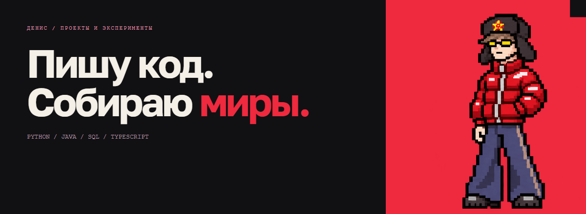

### Денис Петров

18 лет. Второй курс, бизнес-аналитика. Ищу первую работу аналитиком данных или системным аналитиком.

Работаю с SQL, Python/pandas и Яндекс DataLens. Также использую Java, C#, HTML и CSS. В учебных работах — R, dplyr и ggplot2. Английский — B2.

[Портфолио](https://shalombaby666.github.io/) · [Резюме PDF](https://shalombaby666.github.io/denis-resume.pdf) · [Форматы печати](https://shalombaby666.github.io/print.html) · [Telegram @shalombaby777](https://t.me/shalombaby777)

### Основные проекты

- [AlfaHack](https://shalombaby666.github.io/#project=alfa): командный прототип кредитной заявки, проверок и решения по правилам.
- [RepairCalc / SPBTechRun](https://shalombaby666.github.io/#project=repair): расчёт материалов и подбор товаров. Роль в командном README: ML, данные, организация.
- [Отток клиентов банка](https://shalombaby666.github.io/#project=churn): учебный анализ 10 000 клиентов, SQL и интерактивный дашборд.
- [Проверка выгрузки](https://shalombaby666.github.io/#project=quality): пропуски, дубли и форматы CSV/Excel.

[Все 22 проекта](https://shalombaby666.github.io/#work) · [Учебные работы и доклады](https://shalombaby666.github.io/#materials)

### Новые разборы

- [ABC/XYZ-анализ](https://shalombaby666.github.io/reports/abc.html): 270 товаров, явная методика и проверка агрегации.
- [Прогноз возврата](https://shalombaby666.github.io/reports/retention.html): Pipeline, пять фолдов, hold-out ROC AUC 0,652.
- [Сверка банковских показателей](https://shalombaby666.github.io/reports/bank-audit.html): семь расхождений в 28 сравнениях.
- [Модель продаж](https://shalombaby666.github.io/reports/sales-model.html): семь таблиц и проверка ограничений на вымышленных записях.
- [FeedCalc](https://shalombaby666.github.io/reports/feedcalc.html): продолжение RepairCalc, сохранённые расчёты тестового каталога.
- [Календарь «Окно»](https://shalombaby666.github.io/apps/okno/): локальные события и импорт ICS.

### Сертификаты Stepik

- [«Поколение Python»: курс для начинающих](https://stepik.org/cert/2984626)
- [«Поколение Python»: курс для продвинутых](https://stepik.org/cert/3047527)
- [Интерактивный тренажёр по SQL](https://stepik.org/cert/3074248)

### Браузерные проекты и Roblox

[SandFox](https://shalombaby666.github.io/SandFox/) · [Two Gamers](https://shalombaby666.github.io/two-gamers/) · [Starman’s Stare](https://shalombaby666.github.io/starmans-stare/) · [Snow Running](https://shalombaby666.github.io/snow-running/)

[Тыквенный приют](https://shalombaby666.github.io/#project=pumpkin) и [Пепельные земли](https://shalombaby666.github.io/#project=ashlands) — незавершённые Roblox-наработки.

Исходники закрытых проектов остаются приватными. Командные результаты и личная роль отмечены отдельно.
